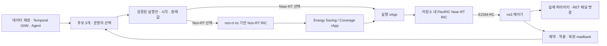

# AGORA 실행 안내

이 저장소의 AGORA 진입점은 `scripts/agora.py`입니다. 기존 데이터로 Temporal GNN·Agent 평가를 실행하고, 운영자가 선택한 후보를 실제 FlexRIC/E2 경로로 ns-3에 적용합니다.

| 구성 요소 | 저장소 경로 |
|---|---|
| Non-RT RIC · A1 Mediator | `non-rt-ric/` |
| Near-RT RIC · FlexRIC와 실행 xApp | `near-rt-ric/` |
| GNN·Agent·정책/제어 모듈 | `smo/` |

소스 폴더와 실행 경로는 위 이름을 사용합니다. FlexRIC의 upstream 프로젝트명·라이브러리명·설정 파일명과 `/usr/local/lib/flexric/` 시스템 설치 경로는 호환성을 유지합니다.

## 바로 실행

```bash
cd /home/user/LENA-oran-flexric-smo
source .venv/bin/activate
python scripts/agora.py up
```

| 화면/서비스 | 주소 |
|---|---|
| Agent UI·후보 선택·적용 상태 | http://127.0.0.1:18081 |
| 기존 GNN 개요 | http://127.0.0.1:8773 |
| Non-RT RIC · standalone A1 API | http://127.0.0.1:9000/docs |
| RIC 제어 게이트웨이 API | http://127.0.0.1:18082/docs |
| Grafana | http://127.0.0.1:3000 |
| InfluxDB 1.8 | http://127.0.0.1:8086 |

`up`은 모니터링 컨테이너와 Near-RT RIC·게이트웨이·Non-RT A1 Mediator·UI를 시작합니다. 8773의 기존 개요 서비스는 변경하거나 재시작하지 않습니다. Grafana의 현재 로컬 계정은 `admin/admin`입니다.

1. UI에서 기준 실행, 판단 시점, 90/180초 구간과 목표·제약을 설정합니다. 먼저 GNN 평가를 완료합니다.
2. 후보 영역에 표시되는 **해당 세션의 시작 명령**을 WSL에서 실행합니다.

   ```bash
   python scripts/agora.py simulate --from-session <세션-ID>
   ```

3. UI의 `실행 새로고침`으로 연결된 ns3 실행을 선택합니다. 평가에 사용한 기준 실행과 11개 초기 파라미터가 일치해야 합니다.
4. 후보 하나를 선택한 뒤 실제 전송 버튼을 누릅니다. 앱 역할에 따라 rApp은 Non-RT, xApp은 Near-RT 경로로 고정됩니다. 제약 위반 후보는 위반을 감수하는 버튼으로 구분됩니다.
5. `ns3 예약 확인 → ns3 적용 확인 → 원래 값 복원 확인`을 확인합니다. 세부 항목에는 시각과 실제 읽어온 파라미터가 있습니다.

예약은 **벽시계가 아닌 시뮬레이션 시각**입니다. 예측이 t=180~360초라면 ns3가 180초에 도달하기 전에 전송해야 합니다. 지난 예측을 임의로 미래로 옮기지 않습니다. 이 경우 동일 실행을 다시 시작하거나 적절한 판단 시점으로 재평가합니다. 시뮬레이션 종료는 복원 시각보다 뒤여야 합니다.

기준 실행만 지정할 수도 있습니다. 전체 학습 trace에는 최대 300명 설정이 필요하므로 과거 명령의 '100명' 제목과 `N_Ues=300`을 혼동하지 마십시오.

```bash
python scripts/agora.py simulate --run gnn_0130 --sim-time 900
python scripts/agora.py status
```

`--gui`로 기존 GUI를 연결하고, `--no-influx`로 InfluxDB 출력을 끌 수 있습니다. GUI 프로세스는 기존 `gui/scripts/run.py` 명령으로 별도 실행합니다. 세션별 실제 명령·trace·초기값은 `launch.json`에 기록됩니다.

## 전달 경로와 적용 계약



Non-RT 경로는 기존 non-rt-ric에서 실행하는 로컬 Non-RT RIC입니다. Energy Saving·Coverage rApp이 동일한 앱 계약으로 원안을 검증한 뒤 실행 xApp으로 전달합니다. Throughput·Load Balancing·Mobility는 xApp이며 Near-RT 경로를 사용합니다. 같은 TxP/RET라도 앱 의도가 다르면 경로가 달라집니다. 학습된 GNN은 변경하지 않습니다.

정책 유형 401은 중첩 실행안 스키마·SQLite 영속 저장·상태 조회를 제공합니다. 실행 게이트웨이는 A1에 저장된 정책과 전달된 값의 일치를 확인합니다. 정책 ID를 재사용해 내용을 바꿀 수 없으며, 삭제 API로 이미 예약된 동작을 취소하지 않습니다. 범용 외부 O-RAN SC 플랫폼이나 완전한 A1 표준 준수 구현으로 주장하지 않습니다.

E2SM-RC에는 로컬 확장 style=401, action=1, parameter=33000을 사용합니다. payload는 하나의 시작·종료 시각과 3개 셀의 5종 파라미터 검사를 담습니다. 이 확장은 표준화된 범용 제어 모델이라고 주장하지 않습니다. `xapp_agora_ctrl.c`와 `agora-ric-controller.cc`가 같은 계약을 구현합니다.

정책 저장, xApp 송신 성공, ns3 적용 성공, 성능 개선은 별개입니다. 적용 성공은 ns3에서 실제 값이 변경된 뒤 생성한 readback으로 확인합니다. readback은 로컬 telemetry 파일이며 **제어 명령을 파일로 직접 전달하는 경로는 없습니다**. 현재 readback은 gNB 설정값/UE CIO/PHY·안테나 상태를 확인하며, 모든 UE의 RRC 재설정 완료나 KPI 목표 달성까지 뜻하지 않습니다.

전체 기준값을 적용 직전에 다시 검사합니다. 명령 ID로 중복 클릭을 제거하며 실행별 제어 lease 하나를 사용합니다. 종료 시 변경한 값만 복원합니다. 다른 제어가 값을 바꾸었다면 덮어쓰지 않고 `restore_conflict`로 알립니다. ns3가 중단되면 미확인 상태를 표시합니다.

| 제어 | 적용 위치 | 현재 GNN/캐시 허용 범위 |
|---|---|---|
| TxP | 셀의 모든 BWP PHY 송신 전력 | 30~43 dBm; 연속값 보간의 예측 한계 유지 |
| RET | 안테나 tilt + 해당 셀의 Sionna 채널 캐시 교체 | 3, 5, 7, 9, 12° |
| CIO | UE RRC의 대상 셀별 A3 offset | 5g: 5~9 dB; 4g1/4g2: -2~2 dB |
| TTT | gNB A3 설정 갱신 후 연결된 UE에 RRC 재설정 | 128~720 ms; 현재 launcher는 Ideal RRC |
| HYS | 같은 A3 설정·RRC 재설정 경로 | 0.5~5 dB, 0.5 dB 단위 |

TTT·HYS는 모델에서 전역 파라미터 두 개이며 세 셀에 함께 적용합니다. Real RRC에서는 인코딩 가능한 TTT 열거값만 허용합니다. 학습값 340/720 ms를 조용히 320/640 ms로 바꾸지 않습니다. 실제 적용은 Near-RT 또는 Non-RT 중 한 경로로 원자적으로 전달합니다. split은 기존 오프라인 대기열에서만 지원합니다.

실제 배포는 다섯 선언 앱 중 하나와 그 앱의 제어 범위가 일치해야 합니다. 복합/사용자 정의 의도는 오프라인 평가를 유지합니다.

현재 canonical 시나리오는 `khu-real-dual-nr-sionna-final`입니다. `4G_1/4G_2`는 데이터셋의 셀 이름이며 여기서는 **1.8 GHz NR**로 시뮬레이션됩니다. 별도 LTE 스택으로 주장하면 안 됩니다.

## RET 캐시 확인 결과

`scenarios/khu-real/ret_caches/` 경로를 유지했습니다.

- `tilt_{3,5,7,9,12}deg/`: 각 각도의 1.8 GHz/3.5 GHz 캐시.
- `merged_percell/`: 4g1·4g2 각도가 다른 20개 조합. 각도가 같은 5개는 위 tilt 캐시 사용.
- 저대역 25개 조합 × 고대역 5개 각도 = 학습 범위의 125개 셀별 조합 전체 사용 가능.
- 1° 캐시와 바깥의 기본 15° 캐시도 존재하지만 현재 GNN 제어 범위에는 포함하지 않습니다.

각 혼합 파일의 셀별 metadata와 960개 채널 표본을 원본과 대조했습니다. 실제 채널 테스트에서는 한 셀의 RET 변경 후 그 셀만 채널 값이 바뀌고 다른 두 셀은 동일했으며, 복원 시 원래 값과 일치했습니다. 실행 중에는 셀 그룹만 선택하므로 125개의 거대한 파일을 추가 생성하지 않습니다.

## 폴더와 실행 결과

| 경로 | 역할 |
|---|---|
| `scripts/agora.py` | 서비스·빌드·시나리오 통합 명령 |
| `smo/agentic_ai/agora_offline/` | 현재 Temporal GNN, Agent, UI, 사용자 설정 |
| `smo/non_rt_ric/` | standalone A1 정책 저장·rApp 처리 |
| `smo/ric_control/` | RIC gateway, 제어 계약, 연결 테스트 |
| `smo/ric_control/config/` | 실제 사용하는 FlexRIC 설정, 실행별 trace 대응표 |
| `near-rt-ric/examples/xApp/c/ctrl/xapp_agora_ctrl.c` | 실제 E2 제어 송신 xApp |
| `contrib/nr/helper/agora-ric-controller.*` | ns3 예약·적용·복원·readback |
| `monitoring/` | InfluxDB/Grafana Compose와 dashboard |
| `experiments/agora_runtime/runs/<실행-ID>/` | 실행 명세, status, receipts, KPI CSV |
| `experiments/agora_runtime/logs/` | 서비스·xApp 로그 |
| `experiments/agora_runtime/backups/` | 이식 전 원본 및 변경 manifest |

서비스·설정·런타임 결과를 구분하고 README에서 새 진입점을 안내했습니다. 데이터셋, RET 캐시, 기존 시나리오, 기존 Agent·대시보드·aimlfw 관련 트리는 의존성을 해제하고 복원 가능한 로컬 보관 위치로 이동했습니다. 결과·DB·백업은 Git 소스에서 제외합니다. 서로 다른 `/home/user/flexric`와 `/home/user/ns-O-RAN-flexric/flexric` 명령을 섞지 말고 이 저장소의 launcher를 사용하십시오.

GNN 실행 ID와 데이터셋 폴더 번호가 다를 수 있습니다. `replay_sources.json`은 1,000개 실행을 실제 UE CSV로 대응시키며, launcher가 SHA-256을 검사합니다. 예: GNN `gnn_0130`은 학습 원본 seed130 경로에 연결됩니다. 단순히 `gnn_0130` 이름의 다른 폴더를 추정해 사용하지 않습니다.

## 모니터링

확인 당시 InfluxDB와 Grafana 컨테이너가 모두 exit 255로 중단되어 있었습니다. 기존 볼륨을 보존하여 재시작하고 `restart: unless-stopped`, healthcheck와 Grafana의 InfluxDB 준비 대기를 추가했습니다. 서비스 health, Grafana datasource, 실제 E2 변경값의 저장·조회까지 확인했습니다. 이전 종료의 정확한 원인은 종료 코드만으로 단정하지 않습니다.

```bash
python scripts/agora.py monitoring
docker compose --project-directory monitoring ps
docker compose --project-directory monitoring logs --tail 60
```

Grafana는 기존 writer의 **벽시계 수신 시각**을 사용하므로 방금 실행한 결과는 최근 15분/1시간 구간으로 조회합니다. 논문 평가의 90/180초 구간은 실행별 `cell_kpi.csv`/`ue_kpi.csv`의 `time_s`를 사용합니다. 여러 실험을 Grafana 시계열만으로 구분하지 마십시오.

## 소스 관리와 재생 데이터 이동

Python·C++·UI 소스는 LF 줄바꿈으로 통일하고, 체크포인트·NPZ·HDF5는 바이너리로 관리합니다. 학습된 체크포인트와 데이터 manifest는 Git에 포함합니다. 두 런타임의 재생 NPZ 2,000개는 로컬에 유지하고 Git에서는 제외합니다. 새 checkout에는 아래 압축본을 별도로 전달해야 데이터 재생이 동작합니다.

```bash
# 기존 환경: 원본 해시 검증 후 이동용 압축본 생성
python scripts/agora_replay.py verify
python scripts/agora_replay.py export experiments/agora_runtime/exports/agora-replay.zip

# 새 환경: 압축본을 전달받은 뒤 복원
python scripts/agora_replay.py import /path/to/agora-replay.zip
```

내보내기는 기존 압축본을 덮어쓰지 않습니다. 가져오기는 manifest에 기록된 전체 파일 목록·크기·SHA-256을 확인한 후에만 설치하며, 정상인 로컬 파일은 유지합니다. 학습 데이터와 실험 결과는 소스 변경과 별도로 보관합니다.

제어 서비스는 `smo/ric_control/gateway.py`의 HTTP API, `dispatch.py`의 검증·정책 저장·xApp 전송, `state.py`의 SQLite 기록·ns3 readback 집계, `protocol.py`의 제어 계약으로 나누었습니다. API와 적용 계약은 유지합니다.

## 검증과 남은 평가

```bash
python scripts/agora.py build
PYTHONPATH=smo/agentic_ai .venv/bin/python -m unittest discover -s smo/agentic_ai/agora_offline/tests
.venv/bin/python -m unittest discover -s smo/ric_control/tests
.venv/bin/python smo/ric_control/tests/integration_e2.py
.venv/bin/python smo/ric_control/tests/integration_e2.py --cached
PYTHONPATH=.venv/lib/python3.12/site-packages ./build/scratch/ns3.48-agora-ret-cache-check-default
```

통합 테스트는 `up` 이후 실행하며 자기 ns3 프로세스만 생성·정리합니다. `--cached`는 검증 시간을 줄인 명시적인 UE 부분집합 제어 테스트입니다. `--smoke`도 표준 NR 채널을 사용하는 제어 테스트이며 전체 GNN 정확도 평가가 아닙니다.

실제 GNN + 브라우저 후보 선택 + FlexRIC/E2 + ns3의 t=180 적용/t=360 복원, 두 RIC 경로의 5종 파라미터 적용, 실제 Sionna 캐시 시나리오의 적용·복원 및 Influx/Grafana 기록을 검증했습니다. 결과는 `experiments/agora_runtime/*-results.json` 등에 남습니다.

현재 GNN 입력은 합의된 **기존 데이터 재생**입니다. 방금 실행한 ns3 KPI 스트림으로 history를 자동 교체하는 완전한 온라인 추론은 이식 범위에 포함하지 않았습니다. 동일 trace·초기값 연결은 비교 조건을 맞추지만 난수·실행 상태의 완전 일치를 보장하지 않습니다. 최종 성능 평가는 동일 조건의 유지/원안/선택안 분기 시뮬레이션과 90/180초 KPI 집계로 수행해야 하며, 제어 연결 테스트만으로 KPI 개선·안전성·900초 전체 실험 완료를 주장하지 않습니다.


## 정리된 SMO와 설정

[smo/README.md](smo/README.md)에 현재 폴더 역할과 앱별 전달 경로를 정리했습니다. LLM 설정은 smo/agentic_ai/.env 또는 프로세스 환경변수에서 읽습니다. 구형 agents 내부 설정은 참조하지 않습니다. 기존 코드·가상환경·상태의 보관 명세는 experiments/agora_runtime/legacy/latest.json입니다.

새 Non-RT 서비스만 실행하려면 python scripts/agora.py non-rt를 사용합니다. 실제 동작 확인은 포트 9000의 /api/non-rt/health, /api/non-rt/apps와 /a1-p/policytypes/401에서 할 수 있습니다. API 정책 상태는 ns3 readback을 반영하며, 저장된 정책 자체가 적용 성공을 뜻하지 않습니다.
